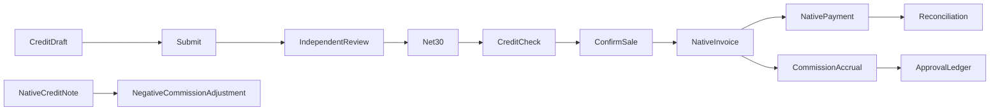

# Source scope

Net-30 applications, independent manager approval, immutable submitted limits,
review notes and chatter; controlled payment terms; sales credit checks using
posted receivables, overdue invoices and unbilled commitments; configurable
commission bases, signed credit-note adjustments and an approval ledger; QWeb
customer statements linked to native invoices are authored.

Configure native chart, bank/cash journals and inbound/outbound payment methods.
Create and post an invoice, use Register Payment for partial/full payments and
native reconciliation; this implementation reuses those native actions rather
than inventing a parallel accounting ledger. Native invoice/sale PDF reports remain.
Create a second finance-manager user to review the seeded draft credit request.
The creator cannot approve their own submitted application. Cron starts disabled.

Proposed policies: 5000 is fictional; limits are company currency. Invoice date
determines commission conversion. Paid basis uses residual proportions, not a
historical bespoke formula. Margin basis uses current standard cost and is not
historical gross margin. Commission entries are accruals/adjustments, not payroll
or vendor payouts. Refund payments are native accounting operations. Historical
statement balances as of a past date are not reconstructed from reconciliation
history; the statement shows current residuals of invoices in the chosen interval.
Code-only: no installation, tests, reconciliation or report rendering was run.

